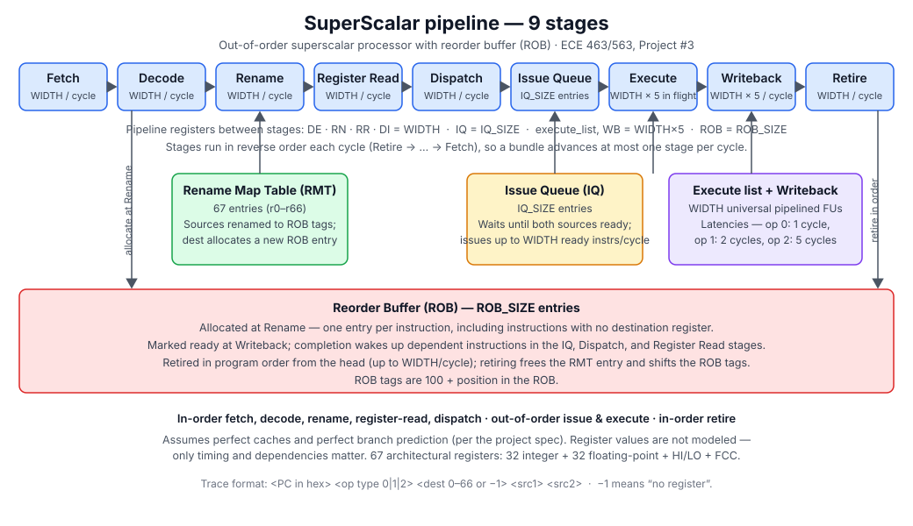
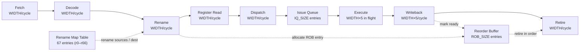
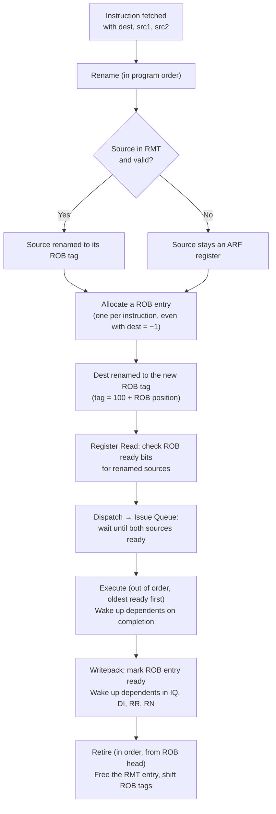
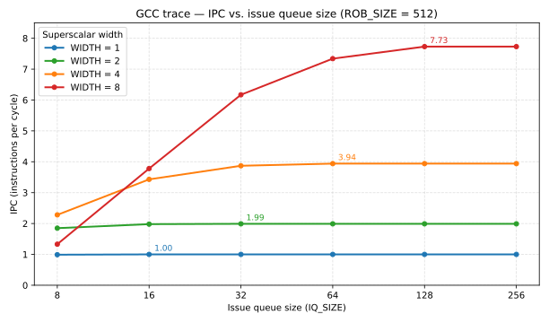
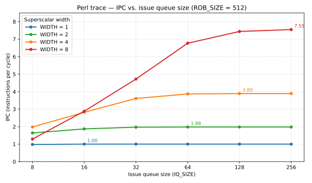
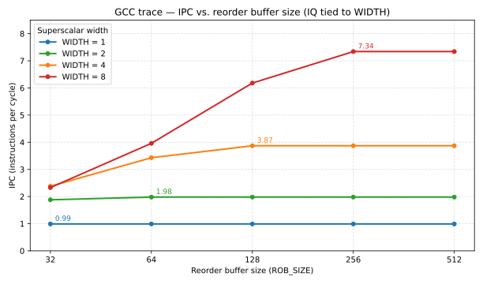
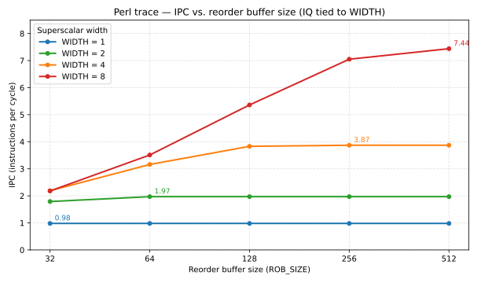

# SuperScalar

A trace-driven simulator for an **out-of-order superscalar processor with a reorder
buffer (ROB)**, written in C++. It replays an instruction trace through a 9-stage
pipeline — fetch, decode, rename, register read, dispatch, issue queue, execute,
writeback, retire — and reports per-instruction pipeline timing, total cycles, and IPC.

Originally built as **Project #3: Dynamic Instruction Scheduling** for
**ECE 463/563 (Fall 2018, Rotenberg)** at NC State University. The course project
specification is in [`projectReport.pdf`](projectReport.pdf) (due Friday,
December 14, 2018).


## What it simulates

- **9-stage pipeline** — Fetch → Decode → Rename → Register Read → Dispatch →
  Issue Queue → Execute → Writeback → Retire. Fetch, decode, rename, register
  read, and dispatch are in order; issue and execute are out of order; retire is
  in order from the head of the ROB.
- **Reorder buffer (ROB)** — `ROB_SIZE` entries. Every fetched instruction allocates
  a ROB entry, including instructions with no destination register. Entries are
  marked ready at writeback and retired in program order, up to `WIDTH` per cycle.
- **Rename Map Table (RMT)** — 67 entries for the 67 architectural registers
  (r0–r66: 32 integer + 32 floating-point + HI/LO + FCC). Sources are renamed to
  ROB tags when the RMT entry is valid; destinations get a fresh ROB tag. ROB tags
  are `100 + position in the ROB` and shift as the head retires.
- **Issue queue (IQ)** — `IQ_SIZE` entries. An instruction waits until both source
  operands are ready, then issues: the queue is scanned in program order and up to
  `WIDTH` ready instructions issue per cycle (not-ready instructions are skipped).
- **Functional units** — `WIDTH` universal pipelined FUs, each able to execute any
  instruction type. Execution latency depends only on the operation type:
  **type 0 = 1 cycle, type 1 = 2 cycles, type 2 = 5 cycles**. A completing
  instruction wakes up its dependents in the IQ and Dispatch stages; writeback
  additionally wakes up dependents in Register Read and Rename and marks the
  instruction ready in its ROB entry.
- **Assumptions (per the spec)** — perfect caches and perfect branch prediction.
  Register values are not modeled at all: only timing and register dependencies
  matter, so the trace carries no opcodes and no data values.
- **Configurable microarchitecture** — three command-line parameters: `ROB_SIZE`,
  `IQ_SIZE`, and `WIDTH` (superscalar width of every stage). Execute and writeback
  are the exceptions: up to `WIDTH × 5` instructions can be in flight in Execute,
  and writeback is not width-limited.

## Architecture





### Pipeline registers

| Register | Between | Size (max # instructions) |
|----------|---------|---------------------------|
| DE | Fetch → Decode | WIDTH |
| RN | Decode → Rename | WIDTH |
| RR | Rename → Register Read | WIDTH |
| DI | Register Read → Dispatch | WIDTH |
| IQ | Dispatch → Issue | IQ_SIZE |
| execute_list | Issue → Execute (incl. FU sub-pipelines) | WIDTH × 5 |
| WB | Execute → Writeback | WIDTH × 5 |
| ROB | Writeback → Retire | ROB_SIZE |

Stages run in **reverse order** each cycle (Retire → Writeback → Execute → Issue →
Dispatch → Register Read → Rename → Decode → Fetch), so a bundle advances at most
one stage per cycle.

### How an instruction flows through rename and the ROB



## Quick start

### Prerequisites

- `g++` (the build uses `-O3 -Wall` and links `-lm`)
- `make`
- A trace file — one instruction per line, e.g.
  [`validationTrace/val_trace_gcc1`](validationTrace/val_trace_gcc1)
  (10,000 instructions) or the 3-instruction sample
  [`code/gcc_trace.txt`](code/gcc_trace.txt)

### Build

From `code/`:

```bash
make          # build ./sim
make clean    # remove .o files and the sim binary
make clobber  # remove .o files (leaves the sim binary)
```

The build is a single translation unit (`sim_proc.cc`); every pipeline stage is a
header in `code/`. It compiles cleanly with `g++ -O3 -Wall` (with ~38 warnings, mostly int/size_t sign comparisons).

### Run

```bash
./sim ROB_SIZE IQ_SIZE WIDTH trace_file
```

For example, from `code/`:

```bash
./sim 256 32 4 ../validationTrace/val_trace_gcc1
```

That runs a 256-entry ROB, 32-entry issue queue, width-4 machine over the included
GCC trace (10,000 instructions).

## Command-line reference

```
./sim <ROB_SIZE> <IQ_SIZE> <WIDTH> <trace_file>
```

| # | Argument | Meaning | Notes |
|---|----------|---------|-------|
| 1 | `ROB_SIZE` | Reorder-buffer entries | Any positive integer |
| 2 | `IQ_SIZE` | Issue-queue entries | Any positive integer |
| 3 | `WIDTH` | Superscalar width (instructions per cycle per stage) | Any positive integer; execute/writeback scale as WIDTH × 5 |
| 4 | `trace_file` | Instruction trace to replay | One instruction per line (see below) |

Exactly 4 arguments are required; anything else prints `Error: Wrong number of
inputs` and exits. An unreadable trace file prints `Error: Unable to open file`
and exits.

### Trace format

One instruction per line:

```
<PC in hex> <op type> <dest reg #> <src1 reg #> <src2 reg #>
```

- `<PC>` is the program counter, in hex.
- `<op type>` is `0`, `1`, or `2` (execution latency 1, 2, or 5 cycles).
- Register numbers are `0`–`66`; **`-1` means the instruction has no register
  there** (e.g. a branch with no destination).

Example ([`code/gcc_trace.txt`](code/gcc_trace.txt)):

```
ab120024 0 1 2 3
ab120028 1 4 1 3
ab12002c 2 -1 4 7
```

## Output

Every run prints, to the console:

1. **One timing line per instruction**, in program order, in the format the course
   **scope tool** consumes (`scope <input-file> <output-file>` renders it as a
   pipeline timing diagram):

   ```
   <seq> fu{<op>} src{<src1>,<src2>} dst{<dst>} FE{<start>,<dur>} DE{<start>,<dur>}
   RN{<start>,<dur>} RR{<start>,<dur>} DI{<start>,<dur>} IS{<start>,<dur>}
   EX{<start>,<dur>} WB{<start>,<dur>} RT{<start>,<dur>}
   ```

   Each `STAGE{start, duration}` pair gives the first cycle the instruction spent
   in that stage and how many cycles it stayed there. The next stage's start equals
   the previous stage's start plus its duration (the scope tool checks this).
   The sources and destination printed are architectural register numbers
   (0–66): internally they are renamed to ROB tags (`100 + ROB position`) during
   rename/issue/execute, and the retire stage converts them back as producers
   retire — verified: no value ≥ 100 appears in any run output.
2. **Simulator command and configuration** — the arguments as parsed.
3. **Simulation results** — dynamic instruction count, total cycles, and IPC
   (instructions retired per cycle, printed to 2 decimals).

### Example run

`./sim 256 32 4 ../validationTrace/val_trace_gcc1` — first four timing lines,
then the summary (verified by rebuilding from source and re-running; full output
is 10,010 lines):

```
0 fu{0} src{29,14} dst{-1} FE{0,1} DE{1,1} RN{2,1} RR{3,1} DI{4,1} IS{5,1} EX{6,1} WB{7,1} RT{8,1}
1 fu{2} src{29,-1} dst{14} FE{0,1} DE{1,1} RN{2,1} RR{3,1} DI{4,1} IS{5,1} EX{6,5} WB{11,1} RT{12,1}
2 fu{2} src{29,-1} dst{15} FE{0,1} DE{1,1} RN{2,1} RR{3,1} DI{4,1} IS{5,1} EX{6,5} WB{11,1} RT{12,1}
3 fu{2} src{30,-1} dst{19} FE{0,1} DE{1,1} RN{2,1} RR{3,1} DI{4,1} IS{5,1} EX{6,5} WB{11,1} RT{12,1}
...
# === Simulator Command =========
./sim rob_size:256 iq_size:32 width:4 tracefile:../validationTrace/val_trace_gcc1
# === Processor Configuration ===
# ROB_SIZE =256
# IQ_SIZE  =32
# WIDTH    =4
# === Simulation Results ========
# Dynamic Instruction Count    = 10000
# Cycles                       = 2584
# Instructions Per Cycle (IPC) = 3.87
```

The 3-instruction sample shows dependency stalls directly — instruction 1 waits
2 cycles in the issue queue for instruction 0's result, and instruction 2 waits
4 cycles for instruction 1's (`./sim 256 32 4 gcc_trace.txt`):

```
0 fu{0} src{2,3} dst{1} FE{0,1} DE{1,1} RN{2,1} RR{3,1} DI{4,1} IS{5,1} EX{6,1} WB{7,1} RT{8,1}
1 fu{1} src{1,3} dst{4} FE{0,1} DE{1,1} RN{2,1} RR{3,1} DI{4,1} IS{5,2} EX{7,2} WB{9,1} RT{10,1}
2 fu{2} src{4,7} dst{-1} FE{0,1} DE{1,1} RN{2,1} RR{3,1} DI{4,1} IS{5,4} EX{9,5} WB{14,1} RT{15,1}
# Dynamic Instruction Count    = 3
# Cycles                       = 16
# Instructions Per Cycle (IPC) = 0.19
```

## Validation

The repo ships the 8 posted course validation runs in
[`validationResults/`](validationResults/) — each file is the full console output
(`val1.txt`–`val8.txt`, 10,010 lines each) plus the corresponding scope-tool
timing diagram (`scope-val1.txt`–`scope-val8.txt`). The course's own check is
`diff -iw <your_output> <posted_output>`.

| Run | Command (`ROB IQ WIDTH trace`) | Instructions | Cycles | IPC |
|-----|-------------------------------|--------------|--------|-----|
| val1 | `16 8 1 val_trace_gcc1` | 10,000 | 10,263 | 0.97 |
| val2 | `16 8 2 val_trace_gcc1` | 10,000 | 7,237 | 1.38 |
| val3 | `60 15 3 val_trace_gcc1` | 10,000 | 3,589 | 2.79 |
| val4 | `64 16 8 val_trace_gcc1` | 10,000 | 2,784 | 3.59 |
| val5 | `64 16 4 val_trace_perl1` | 10,000 | 3,566 | 2.80 |
| val6 | `128 16 5 val_trace_perl1` | 10,000 | 3,408 | 2.93 |
| val7 | `256 64 5 val_trace_perl1` | 10,000 | 2,111 | 4.74 |
| val8 | `512 64 7 val_trace_perl1` | 10,000 | 1,603 | 6.24 |

**Verification performed for this README** (rebuilt from source with
`g++ -O3 -Wall`, re-ran all 8 configurations against the checked-in traces):

- The final measurements — dynamic instruction count, cycles, and IPC — **match
  the posted outputs for all 8 runs**.
- Per-instruction timing matches exactly (`diff -iw`) for **5 of the 8 runs**
  (val1, val2, val3, val7, val8).
- For val4, val5, and val6, only the **last few instructions differ** (16, 4, and
  15 lines respectively), all in the end-of-trace drain phase — the RR/DI/IS
  stage durations of the final bundle. Total cycles and IPC are unaffected.
- Two cosmetic differences apply to every run: the command-echo line uses a
  different format than the posted files (current code prints
  `./sim rob_size:16 iq_size:8 width:1 tracefile:...`; the posted files have
  `# ./sim 16 8 1 val_trace_gcc1`), and each timing line ends with a trailing
  space in the current output (the posted files have none) — which is why a
  plain `diff` flags every line while the spec's `diff -iw` does not.

To validate a fresh build yourself:

```bash
cd code && make
./sim 16 8 1 ../validationTrace/val_trace_gcc1 > /tmp/my_val1.txt
diff -iw /tmp/my_val1.txt ../validationResults/val1.txt
```

## Results and analysis

[`code/bashScript.sh`](code/bashScript.sh) sweeps the three configuration parameters
over the GCC and Perl traces and writes IPC data to CSVs in
[`code/graph/`](code/graph/) (full data: [`graph1.csv`](code/graph/graph1/graph1.csv),
[`graph2.csv`](code/graph/graph2/graph2.csv),
[`graph3.csv`](code/graph/graph3/graph3.csv),
[`graph4.csv`](code/graph/graph4/graph4.csv)). The charts below were regenerated
from those checked-in CSVs. Every CSV value was spot-checked by re-running the
simulator at the same configuration — all spot checks reproduced the CSV exactly
(e.g. `512 256 8` on GCC → IPC **7.73**; `512 128 8` on Perl → IPC **7.44**).

### Graph 1 — IPC vs. issue queue size, GCC trace

ROB fixed at 512 so it is not a bottleneck; IQ swept 8–256, one curve per WIDTH
([`code/graph/graph1/graph1.csv`](code/graph/graph1/graph1.csv),
plot workbook: [`graph1.xlsm`](code/graph/graph1/graph1.xlsm)).



| WIDTH | IPC at IQ 8 | IPC at IQ 32 | IPC at IQ 128 | IPC at IQ 256 | Peak (WIDTH) |
|-------|------------|--------------|---------------|---------------|--------------|
| 1 | 0.99 | 1.00 | 1.00 | 1.00 | 1 |
| 2 | 1.85 | 1.99 | 1.99 | 1.99 | 2 |
| 4 | 2.28 | 3.87 | 3.94 | 3.94 | 4 |
| 8 | 1.33 | 6.17 | 7.73 | 7.73 | 8 |

Best IPC: **7.73** at WIDTH 8 (96.6% of the peak of 8). Note the WIDTH-8 curve at
IQ 8 (1.33) is *below* the WIDTH-4 curve (2.28) — with a tiny issue queue, the
wider machine stalls more, not less.

### Graph 2 — IPC vs. issue queue size, Perl trace

Same sweep on the Perl trace
([`code/graph/graph2/graph2.csv`](code/graph/graph2/graph2.csv),
plot workbook: [`graph2.xlsm`](code/graph/graph2/graph2.xlsm)).



| WIDTH | IPC at IQ 8 | IPC at IQ 32 | IPC at IQ 128 | IPC at IQ 256 | Peak (WIDTH) |
|-------|------------|--------------|---------------|---------------|--------------|
| 1 | 0.98 | 1.00 | 1.00 | 1.00 | 1 |
| 2 | 1.64 | 1.97 | 1.98 | 1.98 | 2 |
| 4 | 1.98 | 3.61 | 3.89 | 3.89 | 4 |
| 8 | 1.29 | 4.72 | 7.44 | 7.55 | 8 |

Best IPC: **7.55** at WIDTH 8 (94.4% of peak). Perl is slightly harder to
parallelize than GCC at the same configuration (e.g. WIDTH 8, IQ 128: 7.44 vs.
7.73), and unlike GCC it is still improving at IQ 256.

### Optimized issue queue size (within 5% of the max)

Per the spec (§8.2.1), the smallest IQ that still achieves within 5% of the IPC
at the largest IQ (256) — computed from `graph1.csv` / `graph2.csv`:

| WIDTH | GCC (graph 1) | Perl (graph 2) |
|-------|---------------|----------------|
| 1 | 8 | 8 |
| 2 | 16 | 32 |
| 4 | 32 | 64 |
| 8 | 128 | 128 |

The pattern is the point of the exercise: the wider the machine, the larger the
issue queue it needs to stay fed — roughly doubling the queue each time the width
doubles. Two borderline cases: GCC at WIDTH 8, IQ 64 reaches 7.34, which is
94.96% of the 7.73 maximum — just under the 5% line, so 128 is the answer; Perl
at WIDTH 2, IQ 16 reaches 1.87, 94.4% of 1.98, so 32 is the answer.

### Graph 3 — IPC vs. ROB size, GCC trace

ROB swept 32–512 with the issue queue tied to the width (WIDTH 1→IQ 8, 2→16,
4→32, 8→64)
([`code/graph/graph3/graph3.csv`](code/graph/graph3/graph3.csv)).



| WIDTH (IQ) | IPC at ROB 32 | IPC at ROB 64 | IPC at ROB 128 | IPC at ROB 256 | IPC at ROB 512 |
|------------|---------------|---------------|----------------|----------------|----------------|
| 1 (8) | 0.99 | 0.99 | 0.99 | 0.99 | 0.99 |
| 2 (16) | 1.88 | 1.98 | 1.98 | 1.98 | 1.98 |
| 4 (32) | 2.38 | 3.43 | 3.87 | 3.87 | 3.87 |
| 8 (64) | 2.33 | 3.96 | 6.18 | 7.34 | 7.34 |

WIDTH 1 is insensitive to ROB size (0.99 everywhere — a width-1 machine never
has more than one instruction in flight per stage). WIDTH 8 saturates at ROB
256; a 32-entry ROB caps it at 2.33, barely above the WIDTH-2 result.

Note: the WIDTH-8 curve here uses IQ 64, which is just below the 5% threshold
from the table above — that is why it plateaus at 7.34 instead of the 7.73 seen
in Graph 1 (IQ 128).

### Graph 4 — IPC vs. ROB size, Perl trace

Same sweep on Perl, with the issue queue tied to the width (1→8, 2→32, 4→64,
8→128)
([`code/graph/graph4/graph4.csv`](code/graph/graph4/graph4.csv)).



| WIDTH (IQ) | IPC at ROB 32 | IPC at ROB 64 | IPC at ROB 128 | IPC at ROB 256 | IPC at ROB 512 |
|------------|---------------|---------------|----------------|----------------|----------------|
| 1 (8) | 0.98 | 0.98 | 0.98 | 0.98 | 0.98 |
| 2 (32) | 1.79 | 1.97 | 1.97 | 1.97 | 1.97 |
| 4 (64) | 2.19 | 3.16 | 3.83 | 3.87 | 3.87 |
| 8 (128) | 2.18 | 3.51 | 5.36 | 7.05 | 7.44 |

Perl's WIDTH-8 curve is still climbing at ROB 512 (7.05 → 7.44), where GCC had
already saturated — the Perl trace exposes more parallelism to a larger window.

### Takeaways

- **IPC tracks WIDTH only when the window is big enough.** At WIDTH 8, shrinking
  the ROB to 32 costs ~70% of the IPC (7.34 → 2.33 on GCC); shrinking the IQ to
  8 costs ~83% (7.73 → 1.33).
- **The issue queue and the ROB must scale together.** The optimized IQ roughly
  doubles with each doubling of WIDTH, and the ROB saturates later for wider
  machines (GCC: ROB 64 for WIDTH 2, 128 for WIDTH 4, 256 for WIDTH 8).
- **The benchmarks differ.** Perl needs a larger IQ and ROB than GCC for the same
  width, and its IPC keeps growing where GCC has saturated — consistent with
  Perl having more independent instructions available in a large window.

## Repository layout

```
SuperScalar/
├── README.md                     # this file
├── projectReport.pdf             # course spec: ECE 463/563 Project #3 (Rotenberg, Fall 2018)
├── code/
│   ├── sim_proc.cc               # main(): CLI parsing, trace loop, results summary
│   ├── sim_proc.h                # proc_params struct (rob_size, iq_size, width)
│   ├── SuperScalar.h             # SuperScalar class: pipeline driver, stage wiring, output
│   ├── Instruction.h             # Instruction: op, registers, per-stage start/duration
│   ├── Fetch.h / Decode.h        # fetch & decode stages (WIDTH/cycle)
│   ├── Rename.h                  # rename: RMT lookup, ROB allocation, tag assignment
│   ├── RegisterRead.h            # register read: ROB ready-bit checks
│   ├── Dispatch.h                # dispatch to the issue queue
│   ├── IssueQueue.h              # IssueQueue entry struct (see Notes — currently unused)
│   ├── IssueQueueStage.h         # issue-queue stage (IQ_SIZE entries)
│   ├── Execute.h                 # execute: oldest-ready-first issue, wakeup, latencies
│   ├── Writeback.h               # writeback: ROB ready, wakeup broadcast
│   ├── Retire.h                  # retire: in-order from ROB head, RMT/ROB-tag cleanup
│   ├── RMT.h                     # rename map table entry (valid + ROB tag)
│   ├── ReorderBuffer.h           # ROB entry (dest, ready, pc, tag)
│   ├── RegisterStages.h          # unused helper (see Notes — does not compile if included)
│   ├── Makefile                  # g++ -O3 -Wall; targets: all, clean, clobber
│   ├── bashScript.sh             # IPC sweeps that produced code/graph/*.csv
│   ├── gcc_trace.txt             # 3-instruction sample trace
│   ├── sim / sim_proc.o          # committed build artifacts (see Notes)
│   └── graph/
│       ├── graph1/               # graph1.csv (GCC, IPC vs IQ) + graph1.xlsm + per-run outputs
│       ├── graph2/               # graph2.csv (Perl, IPC vs IQ) + graph2.xlsm + per-run outputs
│       ├── graph3/               # graph3.csv (GCC, IPC vs ROB) + per-run outputs
│       └── graph4/               # graph4.csv (Perl, IPC vs ROB) + per-run outputs
├── docs/                         # (proposed) architecture.svg, graph1–4 IPC charts
├── validationTrace/
│   ├── val_trace_gcc1            # 10,000-instruction GCC validation trace
│   └── val_trace_perl1           # 10,000-instruction Perl validation trace
└── validationResults/
    ├── val1.txt – val8.txt       # posted reference outputs for the 8 validation runs
    └── scope-val1.txt – scope-val8.txt  # scope-tool timing diagrams for those runs
```

## Roadmap

- Fix the README's run commands and the `bashScript.sh` trace paths (see Notes).
- Add a `validate.sh` script that rebuilds the simulator, runs all 8 validation
  configurations, and `diff -iw`s each against `validationResults/` — so
  validation is one command instead of eight manual runs.
- Add a `.gitignore` and remove the committed build artifacts (`code/sim`,
  `code/sim_proc.o`, `code/graph/.DS_Store`).
- Add a LICENSE file.
- Clean up the dead code (`IssueQueue.h`, `RegisterStages.h`) or wire it in.
- Restore the Graph 1/2 loops in `bashScript.sh` (currently commented out) or
  document that the CSVs are checked-in results.
- CI: build + validation on every push.
- Extend the sweeps: IPC vs. WIDTH at fixed ROB/IQ, and a sensitivity run on the
  FU latencies (op 2 at 3 vs. 5 cycles).
